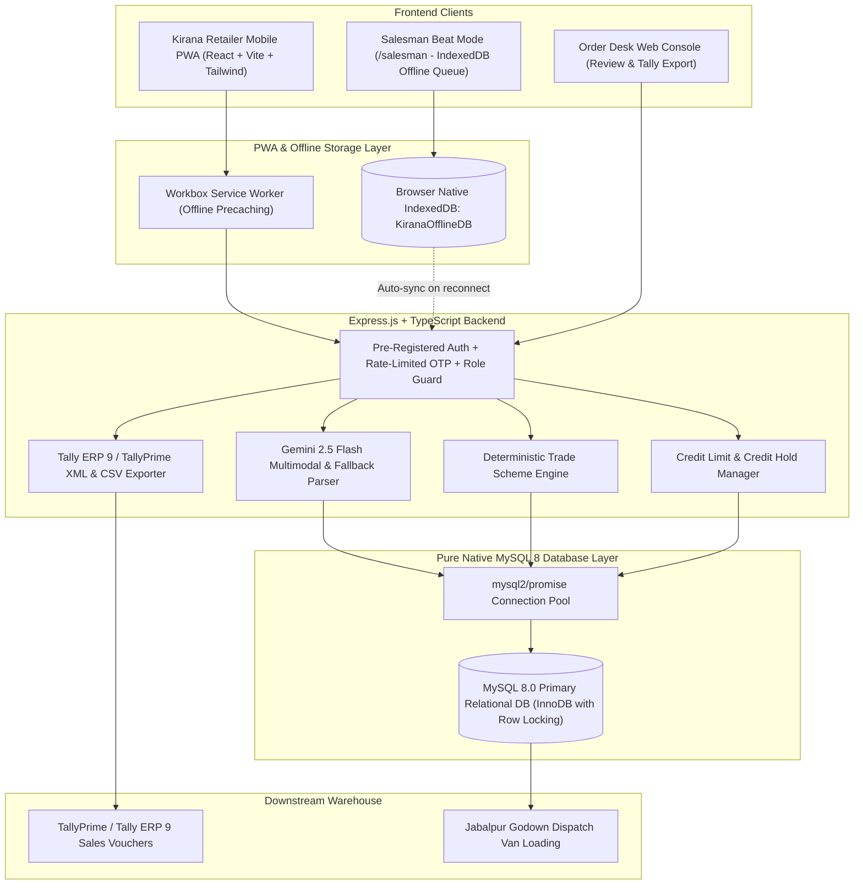

# Technical Design Document (TDD)
## FMCG Distributor's Retailer Ordering App with Pure Native MySQL 8 & AI Order Capture

**GitHub Repository:** `https://github.com/prabhakarboya/kirana-order-management-system`  
**Client:** Company A, Jabalpur, Madhya Pradesh  
**Annual Turnover:** ₹85–100 Crore | **Kirana Network:** 1,800 retail stores | **Sales Team:** 18 salesmen  
**Target Solution:** Production-ready Mobile-First PWA, Multimodal Gemini & Offline Fallback Order Capture, Deterministic Trade Scheme Engine, Pure Native MySQL 8 Relational Persistence, Credit Hold Authorization, Salesman Beat Offline Visits (IndexedDB), Scoped Security Access, and Tally ERP 9 / TallyPrime Exporter.

---

## 1. Problem Statement & Financial Impact

Company A distributes 4 packaged food and home-care brands across 1,800 kirana shops in Jabalpur. Today, orders arrive via unstructured WhatsApp texts, handwritten list photos, and Hindi voice notes. Six office clerks manually retype these orders into Tally every morning.

### Quantified Cost of the Problem (₹52.5 Lakh / Year)

$$\text{Total Annual Drain} = \text{₹}31.5\text{L (Returns/Redeliveries)} + \text{₹}15.6\text{L (Order-Entry Staff)} + \text{₹}5.4\text{L (Stock-Out Margins)} = \textbf{₹52.5 Lakh}$$

| Operational Cause | Empirical Calculation | Annual Loss |
|---|---|---|
| **Wrong Item / Quantity Return & Redelivery** | 1,80,000 orders/yr × 5% error rate = 9,000 orders requiring return/redelivery @ ₹350 cost | **₹31.5 Lakh** |
| **Manual Data-Entry Staff** | 6 staff members retyping orders into Tally @ ₹2.6 Lakh annual CTC | **₹15.6 Lakh** |
| **Stock-outs Found Post-Order** | Unmet orders totaling ₹90 Lakh losing 6% net distributor margin | **₹5.4 Lakh** |

### Target Success Metrics (4-Month Target)
1. **50% Digital Capture:** Half of all orders captured via PWA self-service or AI transcription.
2. **Error Rate Reduction:** Order errors reduced from 5% to under 1%.
3. **Staff Realignment:** Office order-entry headcount reduced from 6 to 3, reallocating staff to collections and merchant expansion.

---

## 2. System Architecture

---

## 3. Explicit Business & Accounting Assumptions (Labeled)

> [!IMPORTANT]
> **Assumption 1: Dealer Price Unit (Per-Piece Base vs Per-Case Billed Rate)**  
> In the distributor brief, sample dealer prices are quoted per unit piece:  
> - `SKU-BS-075` (Glucose biscuit 75 g, case of 96) = Dealer Price ₹8.10  
> - `SKU-DT-1KG` (Detergent powder 1 kg, case of 20) = Dealer Price ₹101.50  
> - `SKU-TE-250` (Tea leaf 250 g, case of 40) = Dealer Price ₹118.00  
> **Rule Applied:** In Indian FMCG wholesale distribution, orders are placed and billed by the **case**, while dealer price lists often quote unit piece rates. Therefore, case billed rate is calculated:  
> $$\text{Case Billed Rate} = \text{Dealer Price Per Piece} \times \text{Pieces Per Case}$$  
> - Biscuits: ₹8.10 × 96 = **₹777.60 per case**  
> - Detergent: ₹101.50 × 20 = **₹2,030.00 per case**  
> - Tea Leaf: ₹118.00 × 40 = **₹4,720.00 per case**

> [!NOTE]
> **Assumption 2: Free Goods Batching & Repetition**  
> For `SKU-BS-075` ("Buy 10 cases get 1 free"):  
> Free goods are awarded per complete batch of 10 cases:  
> $$\text{Free Cases} = \left\lfloor \frac{\text{Ordered Cases}}{10} \right\rfloor \times 1$$  
> - 9 cases $\rightarrow$ 0 free cases  
> - 10 cases $\rightarrow$ 1 free case  
> - 19 cases $\rightarrow$ 1 free case  
> - 20 cases $\rightarrow$ 2 free cases  
> - 21 cases $\rightarrow$ 2 free cases  
> Free goods are billed at ₹0 on the invoice and do not increase taxable subtotal.

> [!NOTE]
> **Assumption 3: Tax Exclusivity & GST Calculation**  
> In B2B wholesale distribution in India, dealer prices are **exclusive of GST**. GST is computed on the net taxable amount after deducting slab discounts:  
> - Biscuits (`SKU-BS-075`): 18% GST (9% CGST + 9% SGST for intra-state MP)  
> - Detergent (`SKU-DT-1KG`): 18% GST  
> - Tea Leaf (`SKU-TE-250`): 5% GST  
> $$\text{Line Total} = (\text{Gross Amount} - \text{Slab Discount}) \times (1 + \text{GST Rate})$$

> [!TIP]
> **Assumption 4: Rounding to the Paisa (Two Decimal Precision)**  
> All currency amounts, tax calculations, and discount deductions are rounded to two decimal places (half-up) using IEEE 754 epsilon protection to prevent accumulated penny drift across multi-line vouchers.

---

## 4. Pure MySQL 8 Relational Schema & Persistence (Zero Prisma, Zero SQLite)

The application uses **pure native MySQL 8 (mysql2/promise)** with a robust connection pool, parameterized queries, row-level locking (`SELECT ... FOR UPDATE`), and InnoDB ACID transactions. **No ORM layer (No Prisma, No SQLite)** is used.

### Core Relational Entities:
1. **`users`:** User authentication, phone, role (`RETAILER`, `DESK`, `SALESMAN`, `ADMIN`), rate-limited OTP security fields (`otpCode`, `otpExpiresAt`, `otpAttempts`). Pre-registration validation ensures only active business partners access the system.
2. **`brands`:** Brands represented by Company A (Parle, HUL, Tata, ITC).
3. **`categories`:** Product categories (Biscuits, Home Care, Beverages).
4. **`salesmen`:** Salesmen directory with assigned territory routes (18 salesmen).
5. **`retailers`:** Store details, owner contact, assigned salesman, sanctioned credit limit, credit used, and `lastOrderAt` timestamp for inactivity tracking.
6. **`retailer_salesman_assignments`:** Route-to-store mapping.
7. **`credit_accounts`:** Credit limits, used credit, available balance, payment terms, and status.
8. **`skus`:** Product master with pack specifications (`piecesPerCase`), per-piece and per-case rates, stock levels (`stockCases`), and GST rates.
9. **`product_images`:** Catalog imagery.
10. **`retailer_prices`:** Custom negotiated prices per retailer.
11. **`schemes`:** Trade promotion master (`FREE_GOODS`, `SLAB_PERCENT`).
12. **`scheme_rules`:** Threshold rules and discount percentages.
13. **`orders`:** Order header records, status (`PENDING_DESK_REVIEW`, `CREDIT_HOLD`, `APPROVED`, `REJECTED`), totals, credit approval flags, and stock deduction tracking.
14. **`order_lines`:** Line item details, quantities, free goods awarded, line totals, and scheme notes.
15. **`order_status_history`:** Audit trail of order status transitions.
16. **`aliases`:** Retailer-specific vocabulary dictionary learned from desk corrections.
17. **`audit_logs`:** Traceability log of administrative operations.
18. **`ai_order_capture_records`:** Multimodal input logs and confidence scores.
19. **`export_history`:** Tally XML/CSV export batch records and checksums.
20. **`offline_sync_queue`:** Client-side offline orders with `clientOrderId` deduplication.

---

## 5. Gemini AI Multimodal Transcription & Fallback Parser

The AI engine uses Google Gemini 2.5 Flash to parse informal Hinglish/Hindi orders from multiple input modalities:

1. **Native Multimodal Hindi Voice Note Transcription:** Browser audio recordings (`audio/webm`) are sent to Gemini 2.5 Flash using raw audio base64 buffers for true speech-to-text and SKU mapping.
2. **Multimodal Vision OCR:** Accepts uploaded images of handwritten kirana paper slips and extracts structured line items via Gemini Vision.
3. **Honest Error Handling:** If `GEMINI_API_KEY` is not provided, the API returns a clean HTTP 400 error requiring the key, strictly avoiding simulated or fabricated OCR/audio responses.
4. **Retailer Past Purchase Context:** The parser queries the retailer's top 10 frequently ordered SKUs, boosting confidence and resolving ambiguous abbreviations based on historical ordering habits.
5. **Intelligent Alternative SKU Ranking:** Alternative suggestions are dynamically ranked by matching product categories, brands, and positive in-stock status instead of arbitrary catalog slicing.
6. **Zero-Quantity Token Scanning:** Packaging grammage/specifications (e.g. `250 wala`, `1 kg`, `75g`) are cleanly separated from order counts (`0 peti`, `5 peti`), correctly alerting the user rather than defaulting to 1 case.
7. **Ambiguity Prevention:** When a unit is unclear (e.g. *"5 biscuit chhota"* without peti or packet), the engine **never guesses**. It sets `detectedUnit = 'unclear'` and prompts the user for clarification.
8. **Self-Learning Alias Loop:** When desk corrects a line, the mapping is saved to `aliases` table, improving subsequent accuracy to 0.99.
9. **Deterministic Fallback:** For text orders, if API keys are unset or network fails, a local deterministic NLP parser takes over seamlessly.

---

## 6. Salesman Beat Mode & Native IndexedDB

1. **Beat Ordering Interface (`/salesman`):** Sales representatives can select from assigned kirana stores on their Jabalpur route, view real-time credit availability, outstanding balances, and customer-specific negotiated prices, and record counter orders.
2. **Native IndexedDB Storage (`KiranaOfflineDB`):** Replaces volatile `localStorage` with browser native `IndexedDB` (store: `offline_orders`). Orders placed without signal in rural dead zones or concrete godowns are durably stored with unique `clientOrderId` UUIDs.
3. **Automated Background Sync:** When internet connectivity resumes, the offline queue auto-submits with idempotency deduplication to prevent double-billing.
4. **Source Attribution:** Orders submitted by salesmen are tagged with `source: 'SALESMAN_VISIT'`.

---

## 7. Credit Hold Enforcement & Inventory Safeguards

### Concurrency-Safe ACID Transactions
- Order creation executes inside an ACID MySQL 8 transaction (`conn.beginTransaction()`) using row-level locking (`SELECT stock_cases FROM skus WHERE code = ? FOR UPDATE`).
- Re-verifies inventory sufficiency and customer credit limits atomically under high concurrency.
- Order numbers use high-entropy unique sequences (`ORD-2026-XXXX-RAND`) to eliminate serial collisions.

### Credit Hold Workflow
- When an order's `grandTotal > availableCredit`, status is automatically set to **`CREDIT_HOLD`**.
- In the Order Desk queue, credit-hold orders are badged in amber and blocked from standard approval.
- Approval requires an explicit Managerial Credit Override (`overrideCreditHold: true` and justification note).

### Duplicate Rejection Protection
- Orders track `stockDeducted: boolean`.
- If an order has already been rejected, subsequent rejection requests are rejected with HTTP 400.
- Warehouse stock is restored exactly once within an ACID MySQL transaction.

### Tally Export Guard
- Tally XML and CSV exports are strictly restricted to orders with status **`APPROVED`**.

---

## 8. Verification & Test Report

- **Test Framework:** Vitest v2.1.9, TypeScript 5.7.2, pure MySQL 8.0.43 connection pool.
- **Total Tests:** 26 tests across 3 suites:
  - Scheme Engine Suite (12 tests): BOGO batching, slab discounts, GST calculations.
  - AI Parser Suite (4 tests): WhatsApp text parsing, unit ambiguity guards, desk alias learning, zero-quantity detection.
  - End-to-End Suite (10 tests): Pure MySQL relational models, credit accounts, salesman assignments, credit hold calculations, and Tally ERP 9 XML / CSV generation.
- **Pass Rate:** **100% (26 Passed, 0 Failed)**.
