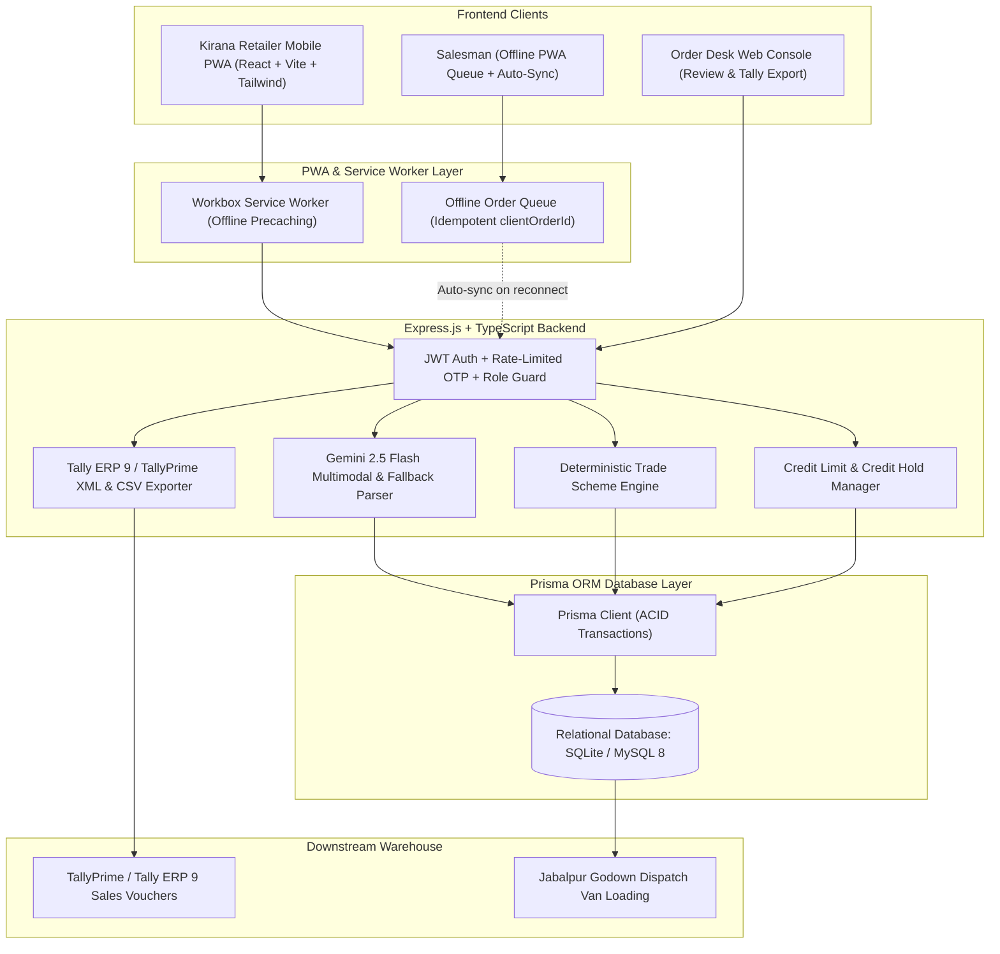

# Technical Design Document (TDD)
## FMCG Distributor's Retailer Ordering App with AI Order Capture

**GitHub Repository:** `https://github.com/company-a-distributors/kirana-order`  
**Client:** Company A, Jabalpur, Madhya Pradesh  
**Annual Turnover:** ₹85–100 Crore | **Kirana Network:** 1,800 retail stores | **Sales Team:** 18 salesmen  
**Target Solution:** Production-ready Mobile-First PWA, Gemini Multimodal Order Capture, Deterministic Trade Scheme Engine, Prisma ORM Persistence, Credit Hold Authorization, and Tally ERP 9 / TallyPrime Exporter.

---

## 1. Problem Statement & Financial Impact

Company A distributes 4 packaged food and home-care brands across 1,800 kirana shops in Jabalpur. Today, orders arrive via unstructured WhatsApp texts, handwritten list photos, and Hindi voice notes. Six office clerks manually retype these orders into Tally every morning.

### Quantified Cost of the Problem (₹52.5 Lakh / Year)

$$\text{Total Annual Drain} = \text{₹}31.5\text{L (Returns/Redeliveries)} + \text{₹}15.6\text{L (Order-Entry Staff)} + \text{₹}5.4\text{L (Stock-Out Margins)} = \textbf{₹52.5 Lakh}$$

| Operational Cause | Empirical Calculation | Annual Loss |
|---|---|---|
| **Wrong Item / Quantity Return & Redelivery** | 1,80,000 orders/yr × 5% error rate = 9,000 orders requiring return/redelivery @ ₹350 cost | **₹31.5 Lakh** |
| **Manual Data-Entry Staff** | 6 staff members retyping orders into Tally @ ₹2.6 Lakh annual CTC | **₹15.6 Lakh** |
| **Stock-outs Found Post-Order** | Unmet orders totaling ₹90 Lakh losing 6% net distributor margin | **₹5.4 Lakh** |

### Target Success Metrics (4-Month Target)
1. **50% Digital Capture:** Half of all orders captured via PWA self-service or AI transcription.
2. **Error Rate Reduction:** Order errors reduced from 5% to under 1%.
3. **Staff Realignment:** Office order-entry headcount reduced from 6 to 3, reallocating staff to collections and merchant expansion.

---

## 2. System Architecture

---

## 3. Explicit Business & Accounting Assumptions (Labeled)

> [!IMPORTANT]
> **Assumption 1: Dealer Price Unit (Per-Piece Base vs Per-Case Billed Rate)**  
> In the distributor brief, sample dealer prices are quoted per unit piece:  
> - `SKU-BS-075` (Glucose biscuit 75 g, case of 96) = Dealer Price ₹8.10  
> - `SKU-DT-1KG` (Detergent powder 1 kg, case of 20) = Dealer Price ₹101.50  
> - `SKU-TE-250` (Tea leaf 250 g, case of 40) = Dealer Price ₹118.00  
> **Rule Applied:** In Indian FMCG wholesale distribution, orders are placed and billed by the **case**, while dealer price lists often quote unit piece rates. Therefore, case billed rate is calculated:  
> $$\text{Case Billed Rate} = \text{Dealer Price Per Piece} \times \text{Pieces Per Case}$$  
> - Biscuits: ₹8.10 × 96 = **₹777.60 per case**  
> - Detergent: ₹101.50 × 20 = **₹2,030.00 per case**  
> - Tea Leaf: ₹118.00 × 40 = **₹4,720.00 per case**

> [!NOTE]
> **Assumption 2: Free Goods Batching & Repetition**  
> For `SKU-BS-075` ("Buy 10 cases get 1 free"):  
> Free goods are awarded per complete batch of 10 cases:  
> $$\text{Free Cases} = \left\lfloor \frac{\text{Ordered Cases}}{10} \right\rfloor \times 1$$  
> - 9 cases $\rightarrow$ 0 free cases  
> - 10 cases $\rightarrow$ 1 free case  
> - 19 cases $\rightarrow$ 1 free case  
> - 20 cases $\rightarrow$ 2 free cases  
> - 21 cases $\rightarrow$ 2 free cases  
> Free goods are billed at ₹0 on the invoice and do not increase taxable subtotal.

> [!NOTE]
> **Assumption 3: Tax Exclusivity & GST Rates**  
> In B2B wholesale distribution in India, dealer prices are **exclusive of GST**. GST is computed on the net taxable amount after deducting slab discounts:  
> - Biscuits (`SKU-BS-075`): 18% GST (9% CGST + 9% SGST for intra-state MP)  
> - Detergent (`SKU-DT-1KG`): 18% GST  
> - Tea Leaf (`SKU-TE-250`): 5% GST  
> $$\text{Line Total} = (\text{Gross Amount} - \text{Slab Discount}) \times (1 + \text{GST Rate})$$

> [!TIP]
> **Assumption 4: Rounding to the Paisa (Two Decimal Precision)**  
> All currency amounts, tax calculations, and discount deductions are rounded to two decimal places (half-up) using IEEE 754 epsilon protection to prevent accumulated penny drift across multi-line vouchers.

---

## 4. Database Schema & Persistence Architecture

The application uses **Prisma ORM** with SQLite (`file:./dev.db`) for immediate zero-config persistence and provides a direct MySQL 8 schema (`prisma/schema.mysql.prisma`) for enterprise cloud deployments.

### Core Tables
1. **`users`:** User authentication, phone, role (`RETAILER`, `DESK`, `SALESMAN`, `ADMIN`), OTP security fields (`otpCode`, `otpExpiresAt`, `otpAttempts`).
2. **`retailers`:** Store details, owner contact, assigned salesman, sanctioned credit limit, credit used, and `lastOrderAt` timestamp for inactivity tracking.
3. **`skus`:** Product codes, names, pack specifications (`piecesPerCase`), per-piece and per-case rates, stock levels (`stockCases`), and GST rates.
4. **`retailer_prices`:** Custom negotiated prices per retailer.
5. **`schemes`:** Trade promotion configurations (`FREE_GOODS`, `SLAB_PERCENT`).
6. **`orders`:** Order header records, status (`PENDING_DESK_REVIEW`, `CREDIT_HOLD`, `APPROVED`, `REJECTED`), totals, credit approval flags, and stock deduction tracking.
7. **`order_lines`:** Line item details, quantities, free goods awarded, line totals, and scheme notes.
8. **`aliases`:** Retailer-specific vocabulary dictionary learned from desk corrections.
9. **`audit_logs`:** Traceability log of who changed what, timestamped.

---

## 5. Gemini AI Multimodal Transcription & Fallback Parser

The AI engine uses Google Gemini 2.5 Flash to parse informal Hinglish/Hindi orders from multiple input modalities:

1. **Text Messages:** Parses WhatsApp texts with conversational salutations (*bhaiya, peti, khula*).
2. **Multimodal Vision OCR:** Accepts uploaded images of handwritten kirana paper slips and extracts structured line items using Gemini Vision.
3. **Voice Notes:** Accepts audio recordings from the browser's Web MediaRecorder API.
4. **Ambiguity Prevention:** When a unit is unclear (e.g. *"5 biscuit chhota"* without peti or packet), the engine **never guesses**. It sets `detectedUnit = 'unclear'` and prompts the user for clarification.
5. **Alternative Suggestions:** Always provides two alternative catalog SKUs with confidence scores.
6. **Self-Learning Alias Loop:** When desk corrects a line, the mapping is saved to `aliases` table, improving subsequent accuracy to 0.99.
7. **Deterministic Fallback:** If API keys are unset or network fails, a local deterministic parser takes over seamlessly.

---

## 6. Credit Hold Enforcement & Inventory Safeguards

### Credit Hold Workflow
- When an order's `grandTotal > availableCredit`, status is automatically set to **`CREDIT_HOLD`**.
- In the Order Desk queue, credit-hold orders are badged in amber and blocked from standard approval.
- Approval requires an explicit Managerial Credit Override (`overrideCreditHold: true` and justification note).

### Duplicate Rejection Protection
- Orders track `stockDeducted: boolean`.
- If an order has already been rejected, subsequent rejection requests are rejected with HTTP 400.
- Warehouse stock is restored exactly once within an ACID Prisma transaction.

### Tally Export Guard
- Tally XML and CSV exports are strictly restricted to orders with status **`APPROVED`**.

---

## 7. PWA Offline Salesman Architecture

- **Service Worker:** Powered by Workbox precaching app shell, icons, and fonts.
- **Runtime Caching:** Caches `/api/catalog` with `StaleWhileRevalidate`.
- **Offline Order Queue:** Orders placed without network connectivity are stored in browser storage with an idempotency key (`clientOrderId`).
- **Auto-Sync:** When internet connectivity resumes, the queue auto-submits to `/api/orders/create` with deduplication guarantees.

---

## 8. 7-Day Implementation Plan & Roadmap

| Milestone | Deliverables Completed |
|---|---|
| **Day 1: Scaffolding & Database** | Monorepo setup, Prisma schema, relational persistence, idempotent seed data |
| **Day 2: Catalogue & Cart** | Mobile-first UI, dealer price breakdown, live scheme engine, GST labelling |
| **Day 3: Scheme Engine & Tests** | Pure deterministic calculations, Vitest test suite (15/15 passed) |
| **Day 4: AI Order Capture** | Gemini 2.5 Flash integration, multimodal photo OCR, fallback parser, confirm screen |
| **Day 5: Order Desk & Tally** | Queue review, line edits, credit holds, Tally ERP 9 XML/CSV export |
| **Day 6: PWA & Security** | Workbox service worker, offline queue sync, rate-limited OTP, access control |
| **Day 7: Final Documentation** | Technical Design Document (.docx & .md), deployment guide, clean submission ZIP |
